<!-- ╔══════════════════════════════════════════════════════════════════╗ -->
<!--               RITESH CHOUDHARY — PROFILE README                      -->
<!-- ╚══════════════════════════════════════════════════════════════════╝ -->

<div align="center">



<!-- Typing animation -->

<br/><br/>

<!-- Status badges -->

&nbsp;&nbsp;

&nbsp;&nbsp;


</div>


## ◆ About Me

```typescript
const ritesh: Developer = {

  name      : "Ritesh Choudhary",
  title     : "Full Stack Developer × AI/ML Enthusiast",
  location  : "Mumbai, India 🇮🇳",

  focus: [
    "Full Stack Web Development (MERN · Next.js)",
    "Data Analysis & Visualization (Python)",
    "Machine Learning Fundamentals",
  ],

  traits: [
    "Clean Architecture Advocate",
    "Scalable REST API Builder",
    "Component-Driven UI Developer",
    "Data-Driven Problem Solver",
  ],

  currentlyExploring : ["Machine Learning", "System Design", "Docker", "CI/CD"],
  openToWork         : true,
  principle          : "Build it right. Ship it fast. Scale it further.",

};
```


## ◆ Tech Stack

<div align="center">
  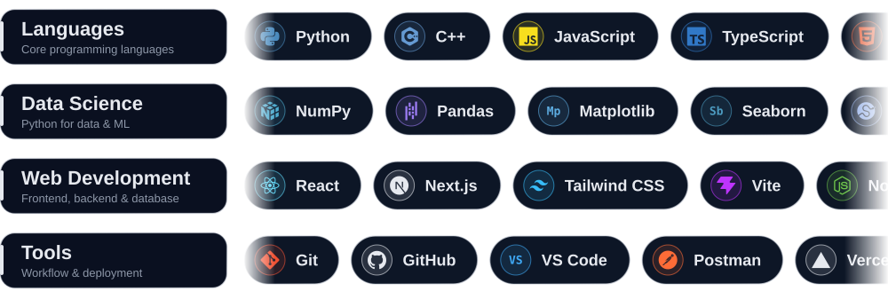
</div>


## ◆ Featured Projects

<div align="center">

<a href="https://github.com/ritesh-builds-dev/boltsync-support-ai"></a>
<a href="https://github.com/ritesh-builds-dev/voice-to-text-recorder"></a>
<a href="https://github.com/ritesh-builds-dev/digital-phone-directory"></a>
<a href="https://github.com/ritesh-builds-dev/WriteUp"></a>

</div>


## ◆ GitHub Analytics


<br /><br />

<p align="center">
  
  
</p>


### ◆ Let's Connect

<div align="center">

<a href="mailto:ritesh.rc.in@gmail.com"></a>
<a href="https://www.linkedin.com/in/ritesh-builds-dev/"></a>
<a href="https://www.instagram.com/__ritesh_choudhary__?dlrf=MTRjZjl3dDZkNXNodw=="></a>

<br/>

<h4 align="center">
  Open to internships · Freelance · Open-Source Collaboration
</h4>

</div>


</div>

<br/>

